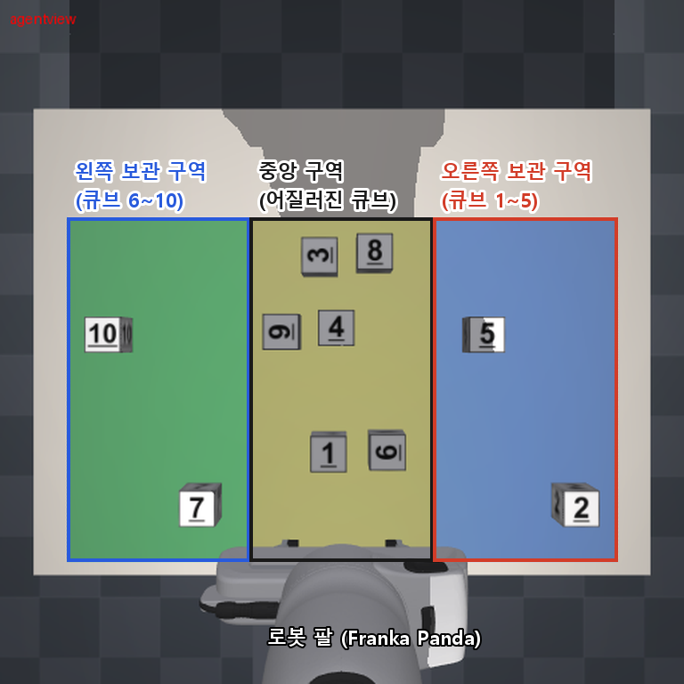
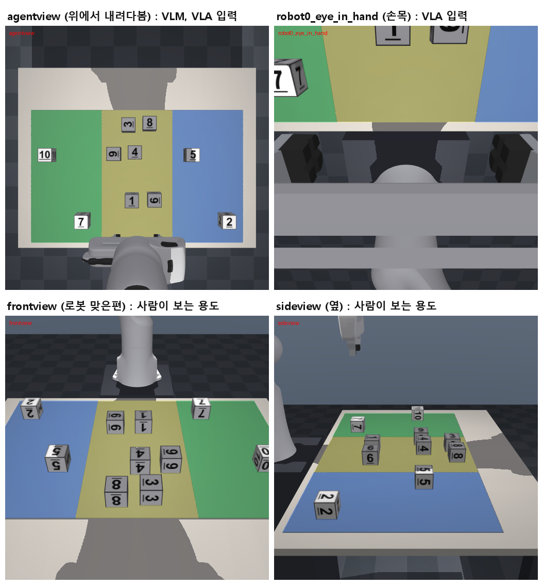
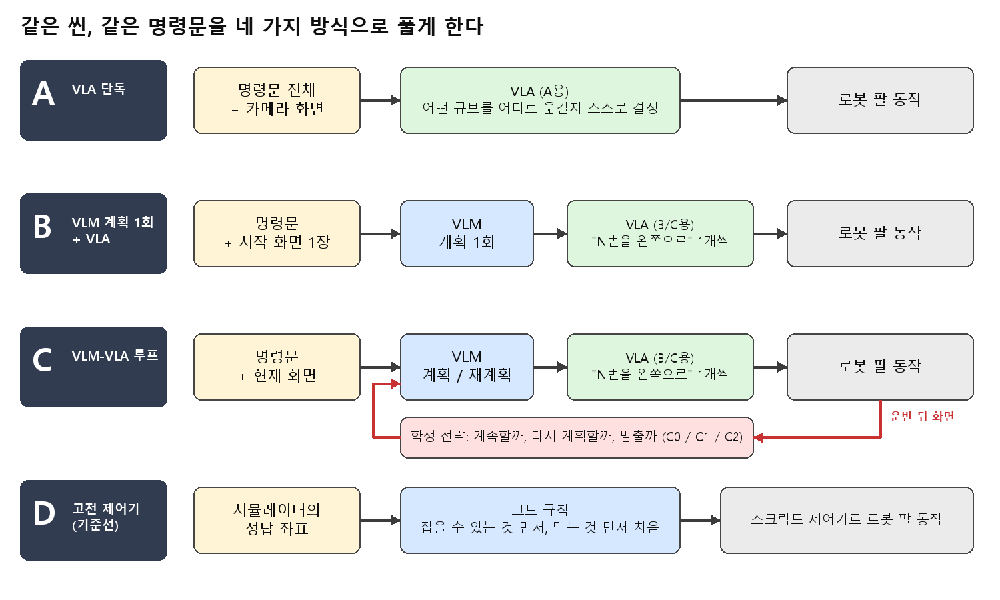
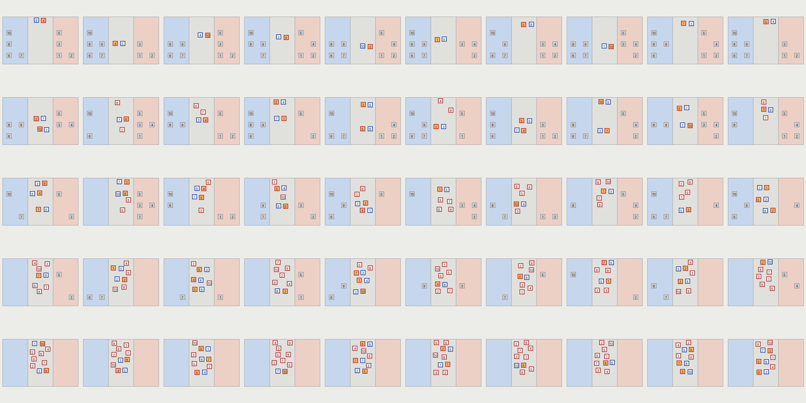
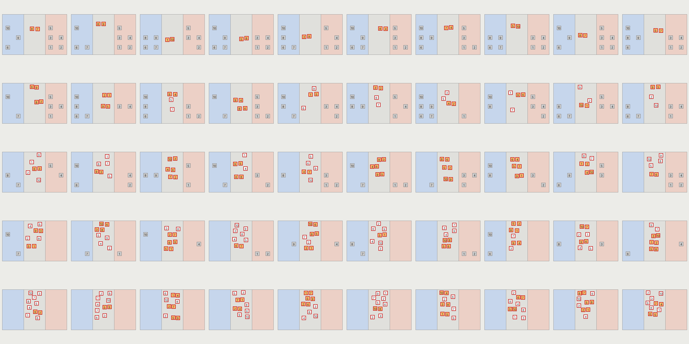

# 1. 실험 세팅 정리 (보고서 작성용)

이 문서는 보고서의 "실험 방법" 부분을 쓸 때 필요한 사실을 모아 둔 것입니다. **학생 전달용은 VLM R5 + motion7k이며, `--shared-vla`로 A/B/C 모두 같은 부분 작업 VLA를 사용합니다.** A는 전체 지시를, B/C는 VLM의 부분 지시를 받습니다. 전체 과제용 A를 따로 학습한 비교가 아니므로 학습 분포 차이를 한계로 적습니다. 추가 학습 중인 모델은 이 고정 실험에 섞지 않습니다.

## 한눈에 보기 (육하원칙)

| | 내용 |
|---|---|
| **누가** | 실험 설계와 C 전략은 학생 3명, 모델 학습과 실험 도구는 조교 |
| **언제** | 테스트 씬 제작과 D 실험은 2026-11-06. A·B·C 실험은 모델 학습이 끝난 뒤 |
| **어디서** | MuJoCo 물리 시뮬레이터 안의 탁자 위. 학습은 조교 PC(RTX 3090 Ti), 실험은 Colab GPU |
| **무엇을** | 숫자가 적힌 큐브 10개를 로봇 팔이 번호에 맞는 보관 구역으로 옮기는 작업 |
| **어떻게** | 같은 씬을 네 가지 방식(A, B, C, D)으로 풀게 하고 정확도, 완료 여부, 시간을 비교 |
| **왜** | 큐브가 서로를 막고 있어 한 번에 풀리지 않을 때, 실행 결과를 다시 보고 계획을 고치는 것(C)이 도움이 되는지 알아보려고 |

## 1. 왜 이런 환경인가

출발점은 **기숙사 로비에 쌓인 택배를 호실별 보관함으로 나누는 로봇**입니다. 실제 택배 더미에는 세 가지 어려움이 있습니다.

1. 상자가 **무작위로 놓여** 있습니다.
2. 옆 상자 때문에 **지금 당장은 집을 수 없는 상자**가 있습니다.
3. 어디로 보낼지는 **겉면에 적힌 글자**를 읽어야 압니다.

이 세 가지만 남기고 나머지를 단순하게 만든 것이 이번 환경입니다.

| 실제 택배 보관 | 이 실험에서 |
|---|---|
| 택배 상자 | 한 변 5cm 정육면체 큐브 10개 |
| 겉면의 수취인 정보 | 큐브 여섯 면에 적힌 숫자 1~10 |
| 호실별 보관함 | 탁자의 왼쪽 구역(6~10번)과 오른쪽 구역(1~5번) |
| 무작위로 쌓인 더미 | 중앙 구역에 무작위로 놓인 큐브 |
| 옆 상자에 가려 꺼낼 수 없음 | 그리퍼 손가락이 내려올 자리를 옆 큐브가 차지함 |

관측과 행동의 형식은 로봇 학습 벤치마크 **LIBERO**의 규격을 따랐습니다. 카메라 이름, 7차원 행동, 로봇 상태 형식이 LIBERO와 같습니다. LIBERO 프로그램을 그대로 쓴 것은 아니고, 같은 규격의 MuJoCo 환경을 따로 만들었습니다. 관측·행동 규격을 맞추면 호환 모델을 연결할 때 코드 변경을 줄일 수 있습니다. 규격 호환성만으로 SmolVLA가 LIBERO 자료에서 사전학습됐다고 주장하지 않습니다.

**한계도 함께 적어야 합니다.** 큐브는 탁자 위에 평평하게 놓여 있고 위아래로 쌓이지 않습니다. 실제 택배의 무게, 크기 차이, 쌓인 더미가 무너지는 문제는 다루지 않습니다. 결론은 "택배 분류를 단순화한 평면 시뮬레이션"까지만 말할 수 있습니다.

## 2. 실험 환경

위 그림은 위에서 내려다본 화면입니다. 로봇은 화면 아래쪽에 있습니다.

| 항목 | 값 |
|---|---|
| 시뮬레이터 | MuJoCo 3.17.0 |
| 로봇 | Franka Emika Panda. 관절 7개와 두 손가락 그리퍼 (최대 벌림 8cm) |
| 작업 영역 | 가로 0.8m × 세로 0.5m. 왼쪽, 중앙, 오른쪽 세 구역으로 3등분 (구역 폭 약 26.7cm) |
| 물체 | 5cm 정육면체 10개. 크기와 모양이 모두 같고 숫자만 다름 |
| 정리 규칙 | 1~5번은 오른쪽 구역, 6~10번은 왼쪽 구역. 구역마다 정해진 자리 5개 |
| 로봇이 닿는 범위 | 로봇 밑동에서 0.30~0.65m |
| 제어 주기 | 1초에 20번 (물리 계산은 0.002초 간격) |
| 행동 | 숫자 7개: 손끝 위치 변화 3개, 회전 변화 3개, 그리퍼 여닫기 1개 |
| 로봇 상태 | 숫자 16개: 관절 각도 7, 그리퍼 2, 손끝 위치 3, 손끝 방향 4 |
| 명령문 | "Tidy up the table: put every numbered object in its designated storage zone." |

### 카메라

| 카메라 | 위치 | 쓰임 |
|---|---|---|
| `agentview` | 탁자 바로 위 약 0.9m에서 수직으로 내려다봄 | VLM 입력(512×512), VLA 입력 |
| `robot0_eye_in_hand` | 로봇 손목 | VLA 입력 |
| `frontview`, `sideview` | 로봇 맞은편, 옆 | 사람이 확인하는 용도. 모델에는 넣지 않음 |

`agentview`를 수직으로 둔 이유는 화면의 왼쪽·오른쪽이 로봇 기준 왼쪽·오른쪽과 같아지기 때문입니다. 로봇 맞은편 카메라는 좌우가 뒤집혀 보입니다.

### 한 번의 실험(trial)에 적용되는 규칙

| 규칙 | 값 |
|---|---|
| 제한 시간 | 300초. 모델이 생각하는 시간도 포함 |
| 최대 스텝 | 6000 |
| B·C 부분 운반 1회 길이 | 240스텝으로 고정. A는 전체 과제 지시를 유지하며 공통 총 시간·스텝 한도까지 연속 실행 |
| 같은 큐브 재시도 | 최대 3회 |
| VLM 호출 횟수 | B는 1회. C는 이번 테스트에서 12회까지 |
| 일찍 끝나는 경우 | 10개가 모두 제자리에 5스텝 연속 있으면 완료 |

### 점수

- **정확도(ACC)**: 10개 중 자기 구역 안에 안정적으로 놓인 큐브의 비율입니다. 큐브 전체가 구역 안에 들어가야 하고, 멈춰 있어야 하고, 그리퍼에 잡혀 있으면 안 됩니다.
- **시작 정확도**: 정리된 큐브도 세기 때문에 0이 아닙니다. 어질러진 큐브가 4개면 시작 정확도는 0.6입니다. 그래서 **끝 정확도에서 시작 정확도를 뺀 값**을 함께 보아야 합니다. 로봇이 큐브를 쳐서 밀어내면 이 값이 음수가 될 수도 있습니다.
- **씬 완료**: 10개가 모두 제자리에 있는 경우입니다.
- 그 밖에 걸린 시간, 스텝 수, VLM 호출 횟수, 큐브별 시도 횟수가 기록됩니다.

## 3. 네 가지 조건

| 조건 | 상황을 어떻게 아는가 | 무엇을 옮길지 누가 정하는가 | 다시 판단하는 때 |
|---|---|---|---|
| **A** | 카메라 화면 | VLA 하나가 명령문 전체를 받고 스스로 | 따로 없음 (계속 실행) |
| **B** | 카메라 화면 | VLM이 시작 화면을 보고 한 번 계획 | 없음. 계획이 끝나면 종료 |
| **C** | 카메라 화면 | VLM이 계획. 학생 전략이 재계획 시점을 정함 | C0, C1, C2마다 다름 |
| **D** | 시뮬레이터의 정답 좌표 | 코드로 쓴 규칙 | 운반 1회가 끝날 때마다 |

- **이번 A/B/C는 같은 VLA 가중치를 씁니다.** A는 전체 과제 지시를 받고 VLM을 호출하지 않습니다. B/C는 부분 지시를 받으며 같은 VLM과 같은 첫 프롬프트를 사용합니다. 부분 작업을 학습한 모델이므로 A의 지시 형식에는 분포 차이가 있습니다. B/C는 루프 정책의 차이를 비교하되 실제 재계획 횟수와 실패 원인도 함께 확인합니다.
- **D는 기준선입니다.** 정답 좌표를 보기 때문에 공정한 경쟁 상대가 아닙니다. "이 씬이 운반만으로 어디까지 풀리는가"를 알려 주는 역할입니다.
- **D의 규칙**: 제자리에 없는 큐브 중 지금 집을 수 있는 것을 로봇에 가까운 순서로 옮깁니다. 집을 수 있는 것이 없으면, 집을 수 있는 '막는 큐브'를 먼저 치웁니다. 그것도 없으면 멈춥니다.
- 사람이 조종하는 조건(E)은 이번 실험에서 뺐습니다.

### C의 세 전략

| 전략 | 다시 계획하는 때 | 장점과 비용 |
|---|---|---|
| **C0** | 받은 계획을 끝까지 실행한 뒤 | VLM 호출이 적음. 실패를 늦게 알아챔 |
| **C1** | 운반 직후 화면을 보고 실패가 의심될 때만 | 필요할 때만 호출. 의심 판정이 틀릴 수 있음 |
| **C2** | 운반이 끝날 때마다 | 가장 빨리 알아챔. VLM 호출 한 번에 20~30초가 듦 |

세 전략 파일은 한 줄(`MODE`)만 다릅니다. C1의 "실패 의심"은 운반 전후의 카메라 화면을 비교해서 판정합니다. 자세한 설명과 생각해 볼 질문은 [STUDENT_COMMENTS.md](STUDENT_COMMENTS.md)에 있습니다.

## 4. 테스트 씬

테스트 씬은 학습에도, 디버깅에도, 모델을 고르는 데에도 쓰지 않은 새 씬입니다. 만들 때 VLM과 VLA는 한 번도 실행하지 않았습니다.

### "막혔다"의 뜻

그리퍼는 큐브를 양옆에서 잡습니다. 두 손가락은 큐브 중심에서 4cm 떨어진 양쪽으로 내려옵니다. **그 자리에서 약 5.5cm 안에 다른 큐브의 중심이 있으면 "막혔다"**고 판정합니다. 이 판정은 D 제어기와 씬 제작에만 쓰이고, A·B·C의 모델에는 알려 주지 않습니다.

### 두 계열

| 계열 | 막는 방식 | D의 결과 |
|---|---|---|
| **oneway** | 막힌 큐브 옆에 90도 돌아간 큐브가 있음. 돌아간 큐브는 손가락 방향이 달라 집을 수 있음 | 막는 큐브를 먼저 치우면 풀림. D는 모두 완료 |
| **mutual** | 같은 방향의 두 큐브가 5.6~7.2cm 간격으로 나란히 놓여 서로를 막음 | D는 이 쌍을 건드리지 않고 멈춤 |

**oneway** (주황 = 막힌 큐브, 파란 테두리 = 90도 돌아간 큐브. 위에서부터 큐브 2, 4, 6, 8, 10개)

**mutual** (주황 = 서로 막는 쌍)

| 항목 | 값 |
|---|---|
| 전체 | 100개 (oneway 50, mutual 50) |
| 어질러진 큐브 수 | 2, 4, 6, 8, 10개. 계열마다 10개씩 |
| 막힌 쌍 | 씬마다 1~3쌍 |
| 이번에 쓰는 부분집합 | `oneway_core10`, `mutual_core10`. 큐브 수마다 2개씩 |
| 고른 방법 | 후보 160개를 만들어 D로 확인. 계열마다 80개 중 75개가 기준 통과. 그중 번호 순서대로 선택 |
| 기존 씬과의 차이 | 가장 비슷한 학습·검증 씬과도 7.3cm 이상 다름 |

- mutual은 학생 검증 씬 `valid_blocked`(큐브 10개가 5쌍으로 서로 막음)와 같은 방식입니다.
- 같은 방향의 큐브끼리는 한쪽만 막히는 배치가 불가능합니다. A가 B를 막으면 B도 A를 막습니다. 그래서 "순서만 맞으면 풀리는 씬"을 만들려면 큐브 하나를 돌려야 했습니다.

## 5. 모델과 학습 (2026-11-06 학생 고정 배포 기준)

### 5-1. 어떤 모델인가

| | VLM (계획) | VLA (동작) |
|---|---|---|
| 원본 모델 | SmolVLM2-500M-Video-Instruct | SmolVLA (`lerobot/smolvla_base`) |
| 입력 | 위에서 본 화면 1장 + 과제 설명 + 실행 기록 | 카메라 2대 화면 + 로봇 상태 16개 + 지시문 |
| 출력 | 큐브별 판단과 운반 순서 (JSON) | 행동 7개 |
| 지금 쓰는 버전 | R5 | A/B/C 공통: motion7k. 부분 작업 지시로 학습한 같은 가중치 |

### 5-2. 학습 자료를 어떻게 모았나

**VLA 자료 (운반 시연)**

- **누가**: 사람이 아니라 D 제어기가 시뮬레이터 안에서 직접 큐브를 옮겼습니다.
- **어떻게**: 씬을 무작위로 만들고, D가 실제 물리로 운반합니다. 성공한 시연만 학습에 썼고 실패한 시연은 보관만 했습니다.
- **무엇을 기록했나**: 카메라 2대 화면, 로봇 상태16, 지시문, 그때의 행동입니다. 모델 입력에 물체 정답 좌표를 넣지 않습니다. 교사가 정답 상태를 이용해 만든 행동을 학습하지만, 추론 입력은 화면·로봇 상태·지시문입니다.
- **나누기**: 학습용과 검증용은 서로 다른 씬(다른 seed)입니다. 같은 씬이 양쪽에 들어가지 않게 했습니다.

| 자료 | 씬 | 분량 |
|---|---|---|
| 1차 | 큐브 1개 운반 20씬 + 전체 정리 6씬 | A용 25개 시연 9,841프레임, B·C용 79개 시연 |
| 2차 | 큐브 3개를 중앙에 무작위 배치 | B·C용 61개 시연 8,762프레임 |
| 목표 대조 | 같은 시작 상태에서 지시하는 큐브만 바꿈 | 58개 시연 7,293프레임 |
| 복구 시연 | 학습 중인 모델이 잘못 움직인 상태에서 D가 바로잡는 부분 | 2,892프레임 |
| **현재 B·C 모델의 학습 자료** | 위 자료 중 성공한 것 + 복구 시연 | 181개 시연 23,173프레임 |
| 이후 확장 | 운반 뒤 50스텝 멈춰 있는 시연, 목표만 바꾼 시연 등 | 최대 76,056프레임 (이 자료로 기준을 넘은 모델은 아직 없음) |

**VLM 자료 (계획 예시)**

- 화면 1장과 "이 상황의 올바른 계획"을 짝지은 예시입니다.
- 정답 계획은 D와 같은 종류의 기하 규칙으로 자동으로 만들었습니다. 사람이 검토한 정답은 아닙니다.
- 처음 보는 화면(initial), 실행 도중의 화면(replan), 다 끝난 화면(done)이 섞여 있습니다.

| 버전 | 학습 예시 수 | 달라진 점 |
|---|---|---|
| r1 | 70 | 처음 |
| R2 | 171 | 실제 운반 시연의 중간 화면 추가 |
| R3 | 372 | 큐브 1개 씬의 시작·종료 화면 추가 |
| R5 | 532 | R3 전체 + 큐브 번호·개수·위치를 무작위로 바꾼 새 화면 160장 |

### 5-3. 어떻게 학습시켰나

모든 학습은 조교 PC의 GPU(RTX 3090 Ti) 한 대에서 했습니다. Colab은 완성된 모델을 내려받아 검증하는 데만 썼습니다.

| | 현재 공통 VLA(부분 작업 학습) | 현재 VLM (R5) |
|---|---|---|
| 시작 모델 | 앞 단계에서 8,000번 학습한 모델 | R3 |
| 학습한 부분 | 행동을 만드는 부분만. 화면을 보는 부분은 고정 | 언어 부분. 화면을 보는 부분은 고정 |
| 학습 횟수 | 8,000번 학습한 실행 중 7,000번째 저장본(motion7k)을 학생용으로 고정 | 480번 |
| 한 번에 보는 자료 | 64개 | 기록에 없음 |
| 학습률 | 0.0001 | 0.00001 |

### 5-4. 검증 결과

| 모델 | 시험 | 결과 |
|---|---|---|
| 이전 VLA motor R2 | 큐브 1개만 나와 있는 씬 10개 | 조교 PC 4/10, Colab 5/10 |
| 이전 VLA motor R2 | 같은 구역에 갈 큐브 3개 중 지시한 번호 옮기기 | 3/30 |
| 공통 VLA motion7k (이번 고정 배포본) | 큐브 1개 씬 20개, 로컬 | 14/20 |
| 공통 VLA motion7k (이번 고정 배포본) | 큐브 3개 중 지시한 1개 옮기기20개, 로컬 | 3/20 |
| 공통 VLA motion7k (Colab 빠른 점검) | 단일5개 / 번호 선택5개, 고정 정책 난수42 | 2/5 / 1/5. 로컬20개와 표본·정책 난수가 달라 직접 합치지 않음 |
| 이전 A용 VLA (r1, 이번 공통 실험에서 사용 안 함) | 검증 씬 10개 | 0/10 |
| VLM R5 | 계획 문제 132개 (Colab) | 옮길 큐브와 구역을 맞힌 정도(F1) 0.93. 순서까지 일치 64% |

**단일 운반과 번호 선택을 구분해야 합니다.** motion7k의 로컬 단일 운반70%는 여러 큐브 정리70%를 뜻하지 않습니다. 같은 가중치에 전체 지시를 주는 이번 A의 성능도 별도로 측정해야 하며, 부분 지시 평가 수치를 A에 그대로 붙이지 않습니다.

### 5-5. 겪은 문제와 대응

| 문제 | 관찰한 것 | 한 일 | 결과 |
|---|---|---|---|
| 처음 모델이 전혀 못 집음 | 검증 씬 0/10, 모두 집는 단계에서 실패 | 학습 횟수를 늘림 | 학습한 씬에서만 성공. 새 씬은 여전히 0/10 |
| 그리퍼가 엉뚱한 곳에서 닫힘 | 큐브가 y 0.413m에 있는데 0.289m 근처에서 닫음 | 씬 종류를 늘리고 화면 보는 부분도 학습 | 최대 2/10. 원인은 가설일 뿐 확정 아님 |
| 학습 설정의 계산 정밀도 결함 | 일부 가중치가 낮은 정밀도로 저장됨 | 높은 정밀도로 저장하도록 수정 | 결함은 고침. 성능은 그것만으로 안 오름 |
| 따라 하기는 되는데 혼자서는 실패 | 정답 동작과의 위치 오차는 4~5mm인데 혼자 실행하면 성공 30% | 목표 위치를 직접 배우게 바꾸고, 복구 시연을 추가 | 큐브 1개 씬 14/20까지 상승. 어느 쪽 덕인지는 가르지 못함 |
| 옮긴 뒤에 다시 건드림 | 한 번 성공한 6개 중 2개가 끝까지 유지 못 함 | 운반 뒤 물러나 멈춰 있는 시연을 수집 | 자료는 준비됨. 효과는 아직 확인 못 함 |
| **지시한 번호를 못 고름** | 3개 중 지시한 큐브 옮기기 3/20 | 목표만 바꾼 시연 수집, 언어 부분 학습 | **미해결** |
| VLM이 같은 말을 반복하다 잘림 | 첫 VLM이 응답 길이 한도까지 반복 | 실제 실행 화면으로 다시 학습 | 형식 오류가 사라짐 |
| VLM이 늘 같은 4개만 계획 | 연습용 씬이 항상 1, 2, 6, 7번이어서 외운 것으로 보임 | 번호와 개수를 무작위로 바꾼 화면 추가 | 새 화면은 나아졌지만 예전 화면에서 나빠짐. 예전 자료를 다시 넣어 해결(R5) |
| GPU 하나에 작업이 몰림 | VLM 학습과 VLA 검증이 겹쳐 메모리가 가득 참 | 한 번에 하나씩 돌도록 잠금 장치 추가 | 해결 |

### 5-6. 보고서에 쓰면 안 되는 말

기록에 "주장하면 안 된다"고 적혀 있는 것들입니다.

- 큐브 1개 씬의 성공률(5/10, 14/20)을 "전체 정리 성공률"이나 "번호 선택 성공률"로 쓰는 것.
- 조교 PC 4/10과 Colab 5/10을 합쳐 "20번 중 9번"이라고 쓰는 것. 같은 씬 10개를 두 번 돌린 것입니다.
- VLM의 F1 0.93을 로봇의 운반 성공률처럼 쓰는 것. 계획 점수입니다.
- 이번 공통 VLA 실험에서 A가 낮다는 이유만으로 "별도로 전체 과제를 학습한 VLA도 항상 못한다"고 쓰는 것. 같은 가중치라도 A의 전체 지시는 부분 작업 학습 때와 다릅니다.
- 학습 중의 오차(loss)가 줄었다는 것을 성공의 근거로 쓰는 것.

## 6. 출처

- 환경 수치: `vla_pipeline/vlapipe/config.py`, `scene.py`, `accessibility.py`
- 실험 규칙과 점수: `vla_pipeline/vlapipe/final_project_v2/runner.py`, `metrics.py`
- 테스트 씬: `repo_overlay/vla_pipeline/outputs/shared_scenes/instructor_test_v2/README.md`, `manifest.json`
- 모델과 학습: 조교용 진행 기록(`MOTOR_R2_STATUS_20261106.md` 등)과 `vla_pipeline/docs/MODEL_RELEASE.md`, `models/release_manifest.json`. 기록에 없는 값은 "기록에 없음"으로 두었습니다.
