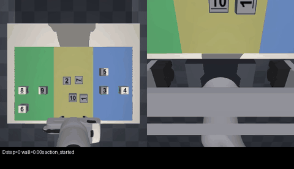
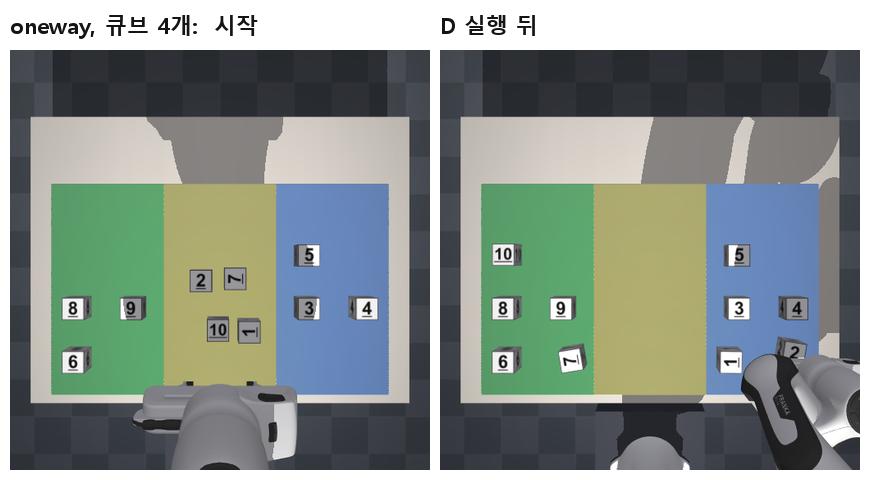
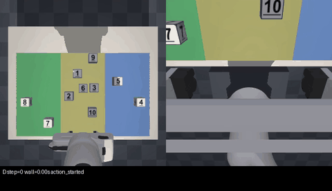
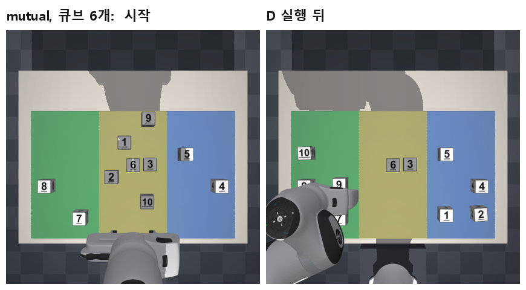
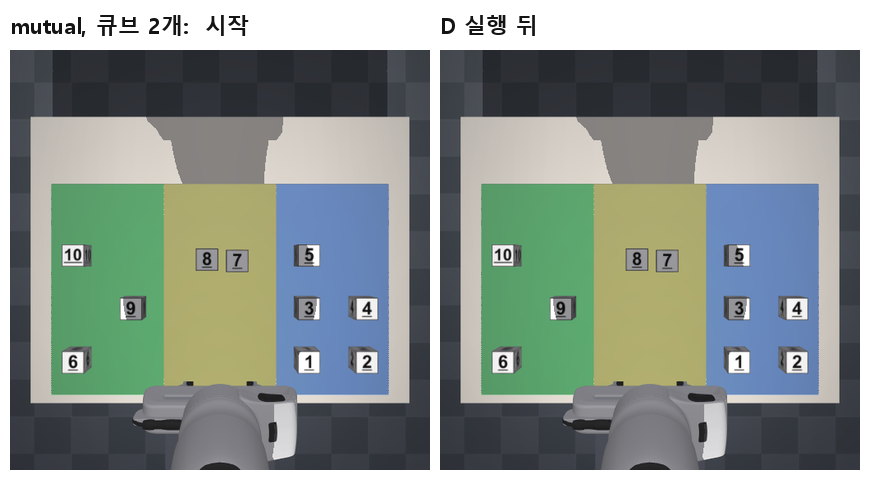
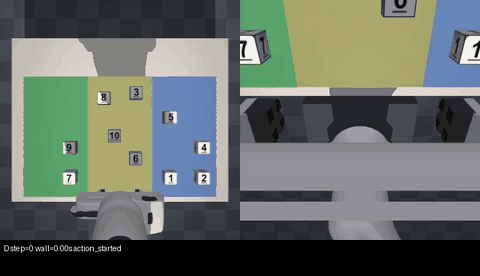

# 2. D 실험 결과 (2026-11-06)

D는 정답 좌표를 아는 고전 제어기입니다. 학습 모델(A, B, C)과 겨루는 상대가 아니라, **"이 씬이 운반만으로 어디까지 풀리는가"를 알려 주는 기준선**입니다.

## 요약

| 계열 | 씬 | 씬 완료 | 정확도 (평균, 시작 → 끝) | 걸린 시간 |
|---|---|---|---|---|
| oneway (한쪽만 막힘) | 10 | **10 / 10** | 0.40 → 1.00 | 13~72초 |
| mutual (서로 막힘) | 10 | **0 / 10** | 0.40 → 0.72 | 0~61초 |
| 참고: 막힘 없는 씬 | 10 | 10 / 10 | 0.45 → 1.00 | 6~78초 |

- **oneway**: D는 막는 큐브를 항상 먼저 치웠고, 10개 씬을 모두 끝냈습니다.
- **mutual**: D는 서로 막는 쌍을 한 번도 시도하지 않았습니다. 나머지 큐브만 모두 옮기고 멈췄습니다.
- 운반 1회에 걸린 시간은 평균 약 7초로 거의 일정했습니다.

## 실험 조건

| | 내용 |
|---|---|
| 언제, 어디서 | 2026-11-06 12:13~12:20, 조교 PC (Windows 11, MuJoCo 3.17.0) |
| 무엇을 | `oneway_core10` 10개, `mutual_core10` 10개 |
| 어떻게 | 공식 실행기 `scripts/final_project_v2.py suite --conditions D --split test --final-test` |
| 규칙 | 제한 300초, 최대 6000스텝, 큐브당 최대 3회 시도 |
| 반복 | 씬마다 1회 (D는 무작위 요소가 없어 다시 돌려도 같은 결과) |

## oneway: 순서를 맞추면 풀리는 씬

*(4배속. 왼쪽은 위에서 본 화면, 오른쪽은 손목 카메라. 큐브 4개, 막힌 쌍 2개인 씬)*

| 씬 | 큐브 | 막힌 쌍 | 정확도 | 시간(초) | 운반 횟수 | D가 옮긴 순서 |
|---|---|---|---|---|---|---|
| scene_0000 | 2 | 1 | 0.8 → 1.0 | 13.3 | 2 | **9** → 4 |
| scene_0001 | 2 | 1 | 0.8 → 1.0 | 13.3 | 2 | **5** → 4 |
| scene_0010 | 4 | 2 | 0.6 → 1.0 | 27.7 | 4 | **1** → 10 → **7** → 2 |
| scene_0011 | 4 | 1 | 0.6 → 1.0 | 27.4 | 4 | 2 → **7** → 9 → 8 |
| scene_0020 | 6 | 3 | 0.4 → 1.0 | 43.4 | 6 | **6** → 1 → **9** → 4 → **3** → 8 |
| scene_0021 | 6 | 2 | 0.4 → 1.0 | 43.4 | 6 | 6 → 9 → **10** → 8 → **7** → 2 |
| scene_0030 | 8 | 1 | 0.2 → 1.0 | 56.7 | 8 | 8 → 1 → 6 → **9** → 7 → 10 → 3 → 4 |
| scene_0031 | 8 | 2 | 0.2 → 1.0 | 58.2 | 8 | 10 → 8 → **2** → 3 → 9 → **5** → 1 → 4 |
| scene_0040 | 10 | 2 | 0.0 → 1.0 | 70.9 | 10 | **3** → 9 → 2 → 7 → 6 → 8 → 5 → 4 → **1** → 10 |
| scene_0041 | 10 | 2 | 0.0 → 1.0 | 71.5 | 10 | **5** → 4 → 10 → **3** → 8 → 2 → 7 → 6 → 1 → 9 |

굵은 숫자는 막는 큐브(90도 돌아간 큐브)입니다. 굵은 숫자 바로 뒤에 그 큐브가 막고 있던 큐브가 옵니다.

**읽을 수 있는 것**

- 모든 씬에서 막는 큐브가 막힌 큐브보다 먼저 옮겨졌습니다. 순서가 반대인 경우는 없습니다.
- 한 번에 성공하지 못해 다시 시도한 운반은 없습니다. 운반 횟수가 큐브 수와 같습니다.
- B와 C가 이 씬을 풀려면 VLM이 이 순서 관계를 화면에서 읽어 내야 합니다. 순서를 틀리면 막힌 큐브를 먼저 집으려다 실패합니다.

## mutual: 서로 막고 있는 씬

*(4배속. 큐브 6개 중 3번과 6번이 서로를 막고 있는 씬. D는 나머지 4개만 옮기고 멈춥니다)*

| 씬 | 큐브 | 막힌 쌍 | 정확도 | 시간(초) | 운반 횟수 | 남은 큐브 |
|---|---|---|---|---|---|---|
| scene_0050 | 2 | 1 | 0.8 → 0.8 | 0 | 0 | 7, 8 |
| scene_0051 | 2 | 1 | 0.8 → 0.8 | 0 | 0 | 8, 9 |
| scene_0060 | 4 | 2 | 0.6 → 0.6 | 0 | 0 | 2, 6, 8, 9 |
| scene_0061 | 4 | 2 | 0.6 → 0.6 | 0 | 0 | 1, 2, 5, 9 |
| scene_0070 | 6 | 1 | 0.4 → 0.8 | 31.9 | 4 | 3, 6 |
| scene_0071 | 6 | 1 | 0.4 → 0.8 | 28.5 | 4 | 3, 9 |
| scene_0080 | 8 | 2 | 0.2 → 0.6 | 31.9 | 4 | 1, 3, 5, 9 |
| scene_0081 | 8 | 2 | 0.2 → 0.6 | 31.3 | 4 | 3, 6, 8, 10 |
| scene_0090 | 10 | 1 | 0.0 → 0.8 | 57.6 | 8 | 2, 9 |
| scene_0091 | 10 | 1 | 0.0 → 0.8 | 60.8 | 8 | 5, 9 |

*(큐브 2개가 전부 서로 막는 쌍인 씬. D는 한 스텝도 움직이지 않아 전후가 같습니다)*

**읽을 수 있는 것**

- 10개 씬 모두에서 남은 큐브는 막힌 쌍과 정확히 일치했습니다. D는 집을 수 있는 큐브를 하나도 빠뜨리지 않았고, 막힌 쌍은 하나도 건드리지 않았습니다.
- 큐브 2개, 4개 씬은 어질러진 큐브가 전부 막힌 쌍입니다. D는 시작하자마자 "할 수 있는 것이 없다"며 멈췄습니다.
- **끝 정확도는 막힌 쌍의 수로 정해집니다.** 1쌍이면 0.8, 2쌍이면 0.6입니다. 이 값이 "운반만으로 얻을 수 있는 점수"입니다.

## A, B, C 결과를 볼 때 이 값을 쓰는 법

| A·B·C의 끝 정확도 | 뜻 |
|---|---|
| D보다 높다 (mutual에서만 가능) | 막힌 쌍을 실제로 떼어 냈다. D의 규칙이 포기한 것을 해냈다 |
| D와 같다 | 운반으로 되는 것은 다 했다 |
| D보다 낮고 시작 정확도보다 높다 | 일부만 옮겼다 |
| 시작 정확도보다 낮다 | 제자리에 있던 큐브를 건드려 밀어냈다 |

mutual에서 D가 멈추는 까닭은 D의 규칙이 "막혔다고 판정한 큐브는 시도하지 않는다"이기 때문입니다. 물리적으로 불가능하다고 증명된 것은 아닙니다. 학습 모델은 이 판정을 모르고 일단 시도합니다. 그 시도가 큐브를 밀어 틈을 만들 수도 있고, 주변을 흐트러뜨릴 수도 있습니다. **어느 쪽인지는 실험해 보아야 압니다.**

## 해석할 때 조심할 점

- **D의 성공률은 성능이 아닙니다.** oneway 씬은 "D가 끝까지 정리한 배치"만 골랐고, mutual 씬은 "D가 쌍만 남기고 멈춘 배치"만 골랐습니다. 위 결과는 씬을 그렇게 골랐기 때문에 나온 것입니다. 걸러 내기 전에는 계열마다 후보 80개 중 75개가 그 기준에 맞았습니다.
- **씬 수가 적습니다.** 계열당 10개이고 큐브 수마다 2개입니다. 큐브 수에 따른 경향을 말하기에는 부족합니다.
- **D의 시간은 A·B·C와 직접 비교할 수 없습니다.** D는 계산이 거의 없고 운반 1회가 약 7초입니다. A·B·C는 운반 1회가 240스텝으로 고정이고 VLM 호출 시간이 더해집니다.

## 참고: 막힘 없는 씬

비교용으로 막힌 큐브가 없는 씬 10개(큐브 1~10개)도 돌렸습니다. 10개 모두 완료했고 6~78초가 걸렸습니다. 큐브 9개 씬에서 한 번 재시도가 있었습니다(운반 10회).

## 자료 위치

이 폴더 기준 경로입니다.

| 자료 | 경로 |
|---|---|
| 실행 영상 (MP4, 실제 속도, 26개) | `videos/v2_oneway/`, `videos/v2_mutual/`, `videos/v1_open/` |
| 위 문서의 그림과 움짤 | `images/` |
| trial별 원본 기록 | `d_results/v2_oneway_core10_D_20261106/scene_XXXX/42/D/` 등 |
| 묶음별 요약표 | `d_results/<묶음>/comparison/results.csv`, `summary.json` |
| 씬 배치 그림과 씬 목록 | `../vla_pipeline/outputs/shared_scenes/instructor_test_v2/` 안의 `overview_oneway.png`, `overview_mutual.png`, `manifest.json` |

- 영상 파일 이름은 `v2_oneway_k04_p2_710400_D.mp4`처럼 계열, 큐브 수(k), 막힌 쌍 수(p), 씬 번호를 담고 있습니다.
- mutual의 큐브 2개·4개 씬 4개는 0스텝이라 영상이 없습니다.
- 영상은 저장된 로봇 상태를 다시 그린 것입니다. 왼쪽 아래 글자는 조건, 스텝, 경과 시간, 마지막 사건입니다.

trial 폴더 안의 파일은 다음과 같습니다.

| 파일 | 내용 |
|---|---|
| `report.json` | 설정, 시작·끝 점수(`initial`, `final`), 종료 이유(`stop_reason`), 요약(`summary`), 사건 목록(`events`) |
| `before.png`, `after.png` | 시작과 끝의 위에서 본 화면 |
| `events.jsonl` | 운반 시작·종료 같은 사건을 시간순으로 |
| `trace.npz` | 스텝마다의 로봇·큐브 상태와 행동 |
| `scene.json` | 실행한 씬 |

`stop_reason`이 `scene_completed`면 10개를 모두 정리한 것이고, `plan_exhausted`면 더 할 수 있는 운반이 없어 멈춘 것입니다.
