# 학생용 시각 보고서 — 로컬120초 A·B·C1 예비 실험

**2026-11-06 / oneway5씬 + mutual5씬 / 총30회 / 실행 오류0건**

> 처음 읽을 때: 시작부터 정리된 큐브가 있다. 최종 ACC42%를 새로42% 정리했다는 뜻으로 쓰면 안 된다. 시작40%에서2%p 증가한 결과다.

[브라우저 보고서](index.html) · [인쇄용 PDF](report.pdf) · [요약 CSV](data/report_table.csv) · [실행별 CSV](data/trial_metrics.csv)

## 1. 무엇을 비교했나

두 계열(oneway·mutual)에서 미리 고정한 씬을5개씩 골랐다. 각 계열은 정리가 필요한 큐브가2·4·6·8·10개인 씬을 하나씩 포함하며, 전체 큐브 수는 항상10개다. 같은 씬·시드42에 A·B·C1을 적용해30회를 평가했다. GPU는 로컬 RTX3090Ti, 시간 제한은120초, 운반 단위는240스텝, 관측 간격은60스텝, 최대 VLM 호출은12회다. VLM R5와 부분 작업 VLA motion7k를 고정하고 세 조건 모두 같은 VLA를 썼다. A는 전체 과제 지시를 받으며 VLM을 호출하지 않는다. B는 VLM 초기 계획1회를 실행하고, C1은 학생의 실패 의심 전략에 따라 재계획한다.

| 조건 | 계획과 실행 |
|---|---|
| A | 전체 지시 → 공통 VLA. VLM 호출0회 |
| B | 초기 VLM 계획1회 → 공통 VLA |
| C1 | B와 같은 첫 계획 → 실행 후 실패 의심 시 재계획 |

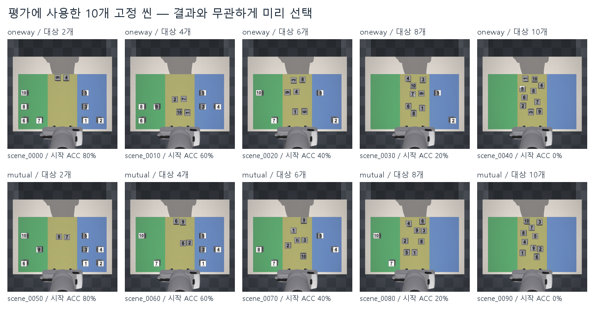

## 2. 전체 결과

| 계열 | 조건 | 시작 ACC | 최종 ACC | 증가 | macro F1 | 씬 완료 | 평균 과제 시간 | VLM 호출 |
|---|---|---|---|---|---|---|---|---|
| oneway | A | 40% | 40% | +0%p | 0.499 | 0/5 | 120.1초 | 0.0회 |
| oneway | B | 40% | 42% | +2%p | 0.533 | 0/5 | 104.4초 | 1.0회 |
| oneway | C1 | 40% | 42% | +2%p | 0.524 | 0/5 | 120.1초 | 2.8회 |
| mutual | A | 40% | 40% | +0%p | 0.492 | 0/5 | 120.1초 | 0.0회 |
| mutual | B | 40% | 42% | +2%p | 0.526 | 0/5 | 102.3초 | 1.0회 |
| mutual | C1 | 40% | 42% | +2%p | 0.506 | 0/5 | 120.0초 | 2.4회 |

값은 각 씬에서 계산한 점수의 산술평균이다. ACC는 정답 구역에 안정적으로 놓인 물체 비율, macro F1은 두 목표 구역의 F1 평균이다. 시간은 추론·제어를 포함하고 모델 로딩·영상 저장은 제외한다. 짧게 끝난 미완료 실행도 포함하므로 성공까지의 시간으로 해석하지 않는다.

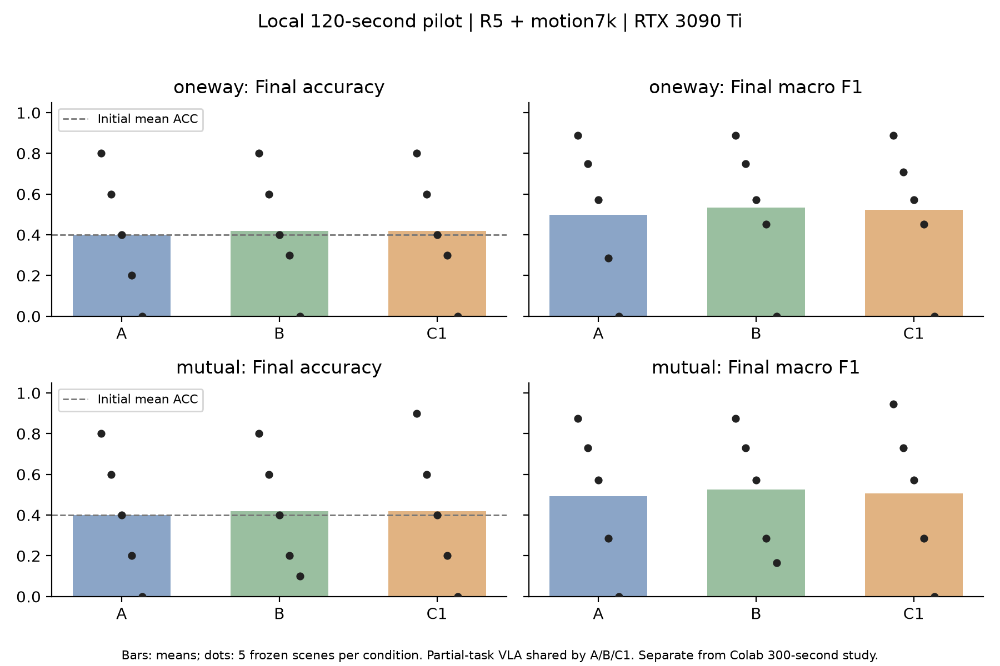

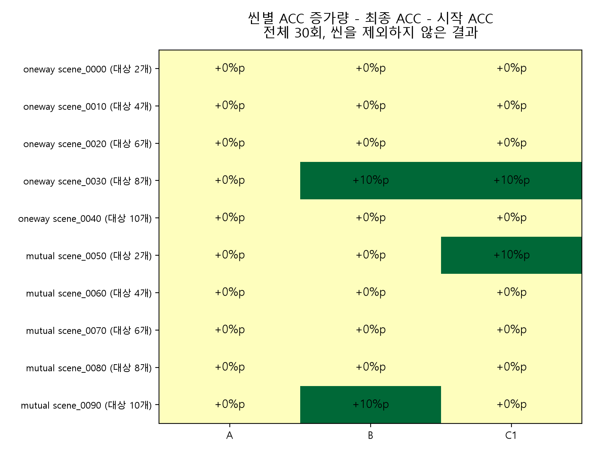

30회 모두 코드 오류 없이 종료했지만 전체 씬 정리 완료는 모든 계열·조건에서0/5회였다. 시작 ACC 평균40%에 대해 A는40%, B·C1은42%였으므로 증가량은 각각0·2·2%p다. 이번 예비 실험에서 C1의 추가 ACC 이득은 관찰되지 않았고 평균 macro F1도 B보다 낮았다. C1은 B보다 VLM을 더 자주 호출했고 평균 과제 시간도 약15.7초(oneway),17.7초(mutual) 길었다. 이는 이번 모델·씬·예산에서의 관찰이며 피드백 루프가 일반적으로 무의미하다는 증거는 아니다.

## 3. 실행 전후와 영상으로 확인하기

본문 사례는 관찰된 네 패턴(둘 다 개선·C1만 개선·B만 개선·모두 미개선)을 설명하려고 고른 것이다. 평균은 사례만이 아니라30회 전부로 계산했다. 전체10씬 그림과30회 영상은 아래 부록에 모두 제공한다.

원본 process.mp4는 시뮬레이션 시간 기준이며 VLM 추론 대기를 그대로 재생하지 않는다. 영상 자막의 wall은 실제 과제 시간이다. 별도 A/B/C1 비교 영상은 trace.wall로0~120초를 맞춰 VLM 대기 중에는 직전 기록 프레임, 종료 뒤에는 최종 프레임을 유지한다. 실제로 없던 동작을 보간하지 않았다. 끝점까지 포함해 비교 영상 길이는 약120.2초다. 점수는 원본 실험의120초 제한 결과를 그대로 쓴다.

### 사례1. B와 C1이 같은 물체를 정리한 사례 — oneway/scene_0030

시작 ACC는20%였다. A는20%를 유지했고, B와 C1은8번 큐브를 새로 정리해30%가 됐다. C1은 VLM을2회 호출했지만 B(1회)보다 최종 ACC가 높지는 않았다. 세 조건 모두 전체 정리는 완료하지 못했다.

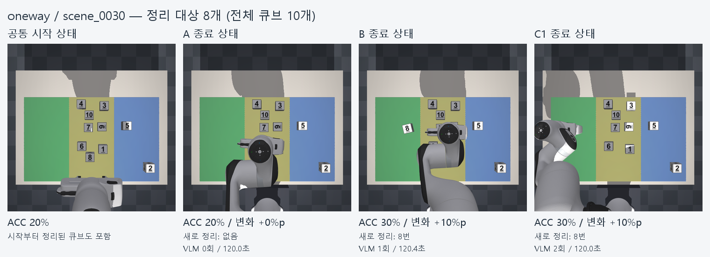

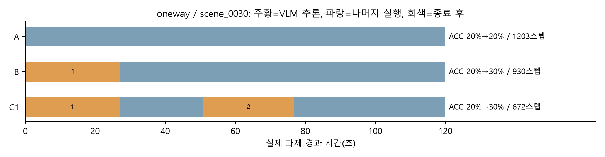

[A/B/C1 실제시간 동기화 비교 영상](videos/oneway_scene_0030_wall_comparison.mp4)

### 사례2. C1에서만 정확도가 증가한 사례 — mutual/scene_0050

시작 ACC는80%였다. A와 B는80%를 유지했고 C1은8번 큐브를 새로 정리해90%가 됐다. 이 씬에서 C1이 B보다 나았다는 관찰은 맞지만, 이를 전체 전략의 우수성으로 확대하지 않는다.

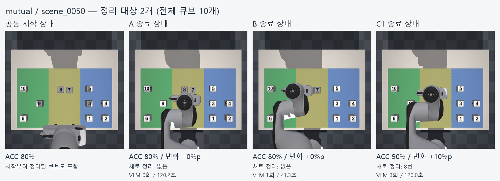

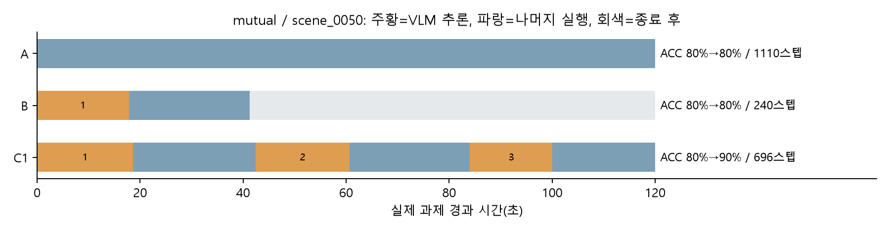

[A/B/C1 실제시간 동기화 비교 영상](videos/mutual_scene_0050_wall_comparison.mp4)

### 사례3. B에서만 정확도가 증가한 반대 사례 — mutual/scene_0090

처음에는10개 모두 정리가 필요했다. B는4번 큐브를 새로 정리해10%가 됐지만 A와 C1은0%였다. C1만 개선된 앞 사례와 반대되는 결과로, 평균이 같아도 개선된 씬은 다를 수 있음을 보여 준다. 추가 추론 시간과 계획 내용이 함께 달라 원인을 하나로 단정할 수 없다.

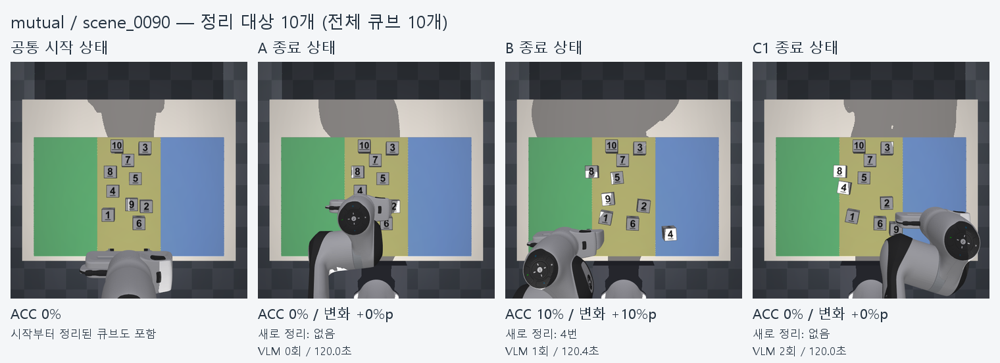

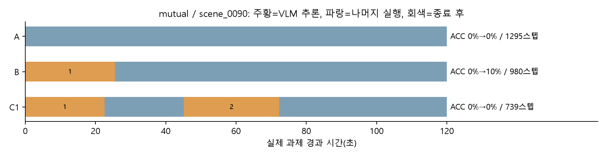

[A/B/C1 실제시간 동기화 비교 영상](videos/mutual_scene_0090_wall_comparison.mp4)

### 사례4. 세 조건 모두 정확도가 증가하지 않은 사례 — oneway/scene_0040

처음에는10개 모두 정리가 필요했고 A·B·C1 모두 최종 ACC0%였다. 코드 오류가 아니라 제한 시간 안에 정확도를 높이지 못한 결과다. 본문에 개선 사례만 남기지 않기 위해 이 실패 사례를 함께 제시한다.

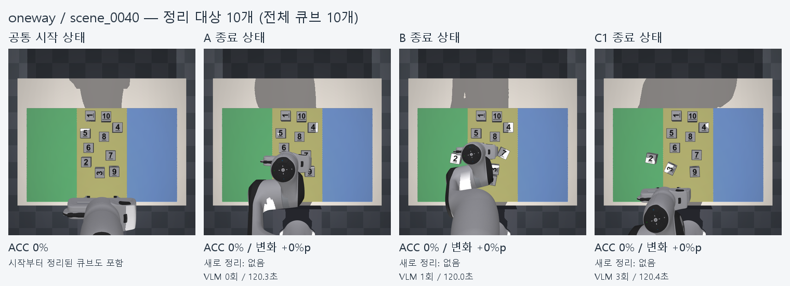

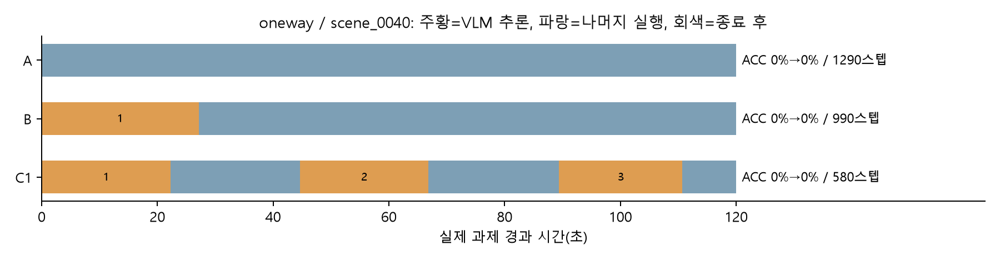

[A/B/C1 실제시간 동기화 비교 영상](videos/oneway_scene_0040_wall_comparison.mp4)

## 4. 보고서에 적을 수 있는 문장

> 본 예비 실험에서는 두 계열 모두 B와 C1의 최종 ACC 평균이42%로 같았으며, 시작 ACC40%에서 각각2%p 증가했다. C1은 일부 씬에서 B보다 높은 ACC를 보였지만 반대 사례도 존재했고, 전체 평균 ACC의 추가 개선은 관찰되지 않았다. C1의 추가 VLM 호출 비용과 하위 행동 모델의 제한을 고려해, 이번 소규모 결과만으로 피드백 루프의 일반적인 효과를 단정하지 않았다.

## 5. 해석의 한계

- 학생 Colab300초 실험과 별도인 로컬120초 예비 실험이다. 모델·장비·시간 조건이 다른 결과를 한 평균으로 합치지 않는다.
- 계열별 독립 씬은5개, 정책 시드는1개다. 30회 실행을30개 독립 씬으로 쓰지 않는다. 같은 번호 큐브를50번 관측했다고 독립 표본50개로 세지 않는다.
- A에도 부분 작업으로 학습한 VLA를 사용했다. 전체 과제 지시의 학습 분포 차이가 있어, 별도로 전체 과제를 학습한 A와의 공정한 우열 비교는 아니다.
- oneway는90도 회전 큐브를 포함하고 mutual은 서로 막는 쌍을 포함한다. 막힘 방식과 회전의 영향을 이 두 묶음만으로 분리할 수 없다.
- 정답 좌표를 쓰는 D로 씬을 선정했다. D의 선정 점수를 학습 모델과의 독립적인 경쟁 성능으로 해석하지 않는다.
- B/C1의 초기 물리 상태·프롬프트·첫 VLM 응답은10쌍 모두 같다. 실제 VLM 영상은9쌍이 완전히 같고 mutual scene_0050의 RGB채널2개만 각각1/255 차이가 있었다. 원본과 차이 검사를 보존했다.
- 새로 정리된 큐브 번호는 실행 후 정답 물리 상태로 채점했다. 이 채점 결과를 VLM/VLA의 실행 입력으로 제공한 것은 아니다.

## 부록. 전체10씬과30회 원본 영상

모든 실행의 점수·전후 그림·원본 영상·report.json을 제공한다. 과정이 좋지 않다는 이유로 제외한 씬은 없다.

### oneway / scene_0000 — 정리 대상2개

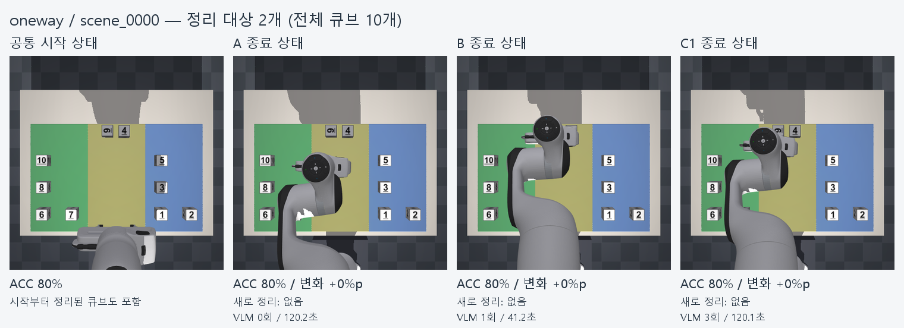

| 조건 | ACC | 증가 | F1 | 영상 | 그림 | 원본 |
|---|---|---|---|---|---|---|
| A | 80%→80% | +0%p | 0.889 | [원본 영상](trials/oneway/scene_0000/42/A/process.mp4) | [전](trials/oneway/scene_0000/42/A/before.png) / [후](trials/oneway/scene_0000/42/A/after.png) | [기록](trials/oneway/scene_0000/42/A/report.json) |
| B | 80%→80% | +0%p | 0.889 | [원본 영상](trials/oneway/scene_0000/42/B/process.mp4) | [전](trials/oneway/scene_0000/42/B/before.png) / [후](trials/oneway/scene_0000/42/B/after.png) | [기록](trials/oneway/scene_0000/42/B/report.json) |
| C1 | 80%→80% | +0%p | 0.889 | [원본 영상](trials/oneway/scene_0000/42/C/process.mp4) | [전](trials/oneway/scene_0000/42/C/before.png) / [후](trials/oneway/scene_0000/42/C/after.png) | [기록](trials/oneway/scene_0000/42/C/report.json) |

### oneway / scene_0010 — 정리 대상4개

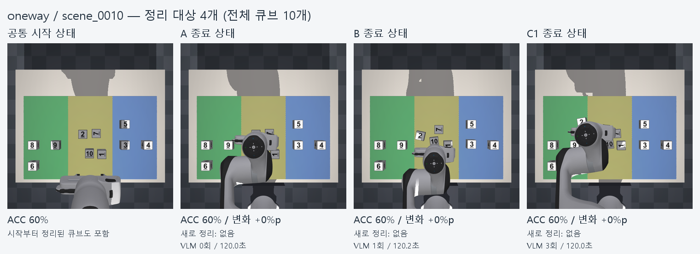

| 조건 | ACC | 증가 | F1 | 영상 | 그림 | 원본 |
|---|---|---|---|---|---|---|
| A | 60%→60% | +0%p | 0.750 | [원본 영상](trials/oneway/scene_0010/42/A/process.mp4) | [전](trials/oneway/scene_0010/42/A/before.png) / [후](trials/oneway/scene_0010/42/A/after.png) | [기록](trials/oneway/scene_0010/42/A/report.json) |
| B | 60%→60% | +0%p | 0.750 | [원본 영상](trials/oneway/scene_0010/42/B/process.mp4) | [전](trials/oneway/scene_0010/42/B/before.png) / [후](trials/oneway/scene_0010/42/B/after.png) | [기록](trials/oneway/scene_0010/42/B/report.json) |
| C1 | 60%→60% | +0%p | 0.708 | [원본 영상](trials/oneway/scene_0010/42/C/process.mp4) | [전](trials/oneway/scene_0010/42/C/before.png) / [후](trials/oneway/scene_0010/42/C/after.png) | [기록](trials/oneway/scene_0010/42/C/report.json) |

### oneway / scene_0020 — 정리 대상6개

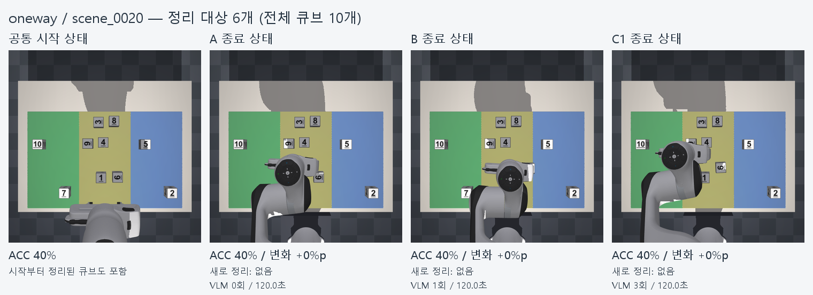

| 조건 | ACC | 증가 | F1 | 영상 | 그림 | 원본 |
|---|---|---|---|---|---|---|
| A | 40%→40% | +0%p | 0.571 | [원본 영상](trials/oneway/scene_0020/42/A/process.mp4) | [전](trials/oneway/scene_0020/42/A/before.png) / [후](trials/oneway/scene_0020/42/A/after.png) | [기록](trials/oneway/scene_0020/42/A/report.json) |
| B | 40%→40% | +0%p | 0.571 | [원본 영상](trials/oneway/scene_0020/42/B/process.mp4) | [전](trials/oneway/scene_0020/42/B/before.png) / [후](trials/oneway/scene_0020/42/B/after.png) | [기록](trials/oneway/scene_0020/42/B/report.json) |
| C1 | 40%→40% | +0%p | 0.571 | [원본 영상](trials/oneway/scene_0020/42/C/process.mp4) | [전](trials/oneway/scene_0020/42/C/before.png) / [후](trials/oneway/scene_0020/42/C/after.png) | [기록](trials/oneway/scene_0020/42/C/report.json) |

### oneway / scene_0030 — 정리 대상8개


| 조건 | ACC | 증가 | F1 | 영상 | 그림 | 원본 |
|---|---|---|---|---|---|---|
| A | 20%→20% | +0%p | 0.286 | [원본 영상](trials/oneway/scene_0030/42/A/process.mp4) | [전](trials/oneway/scene_0030/42/A/before.png) / [후](trials/oneway/scene_0030/42/A/after.png) | [기록](trials/oneway/scene_0030/42/A/report.json) |
| B | 20%→30% | +10%p | 0.452 | [원본 영상](trials/oneway/scene_0030/42/B/process.mp4) | [전](trials/oneway/scene_0030/42/B/before.png) / [후](trials/oneway/scene_0030/42/B/after.png) | [기록](trials/oneway/scene_0030/42/B/report.json) |
| C1 | 20%→30% | +10%p | 0.452 | [원본 영상](trials/oneway/scene_0030/42/C/process.mp4) | [전](trials/oneway/scene_0030/42/C/before.png) / [후](trials/oneway/scene_0030/42/C/after.png) | [기록](trials/oneway/scene_0030/42/C/report.json) |

### oneway / scene_0040 — 정리 대상10개


| 조건 | ACC | 증가 | F1 | 영상 | 그림 | 원본 |
|---|---|---|---|---|---|---|
| A | 0%→0% | +0%p | 0.000 | [원본 영상](trials/oneway/scene_0040/42/A/process.mp4) | [전](trials/oneway/scene_0040/42/A/before.png) / [후](trials/oneway/scene_0040/42/A/after.png) | [기록](trials/oneway/scene_0040/42/A/report.json) |
| B | 0%→0% | +0%p | 0.000 | [원본 영상](trials/oneway/scene_0040/42/B/process.mp4) | [전](trials/oneway/scene_0040/42/B/before.png) / [후](trials/oneway/scene_0040/42/B/after.png) | [기록](trials/oneway/scene_0040/42/B/report.json) |
| C1 | 0%→0% | +0%p | 0.000 | [원본 영상](trials/oneway/scene_0040/42/C/process.mp4) | [전](trials/oneway/scene_0040/42/C/before.png) / [후](trials/oneway/scene_0040/42/C/after.png) | [기록](trials/oneway/scene_0040/42/C/report.json) |

### mutual / scene_0050 — 정리 대상2개


| 조건 | ACC | 증가 | F1 | 영상 | 그림 | 원본 |
|---|---|---|---|---|---|---|
| A | 80%→80% | +0%p | 0.875 | [원본 영상](trials/mutual/scene_0050/42/A/process.mp4) | [전](trials/mutual/scene_0050/42/A/before.png) / [후](trials/mutual/scene_0050/42/A/after.png) | [기록](trials/mutual/scene_0050/42/A/report.json) |
| B | 80%→80% | +0%p | 0.875 | [원본 영상](trials/mutual/scene_0050/42/B/process.mp4) | [전](trials/mutual/scene_0050/42/B/before.png) / [후](trials/mutual/scene_0050/42/B/after.png) | [기록](trials/mutual/scene_0050/42/B/report.json) |
| C1 | 80%→90% | +10%p | 0.944 | [원본 영상](trials/mutual/scene_0050/42/C/process.mp4) | [전](trials/mutual/scene_0050/42/C/before.png) / [후](trials/mutual/scene_0050/42/C/after.png) | [기록](trials/mutual/scene_0050/42/C/report.json) |

### mutual / scene_0060 — 정리 대상4개

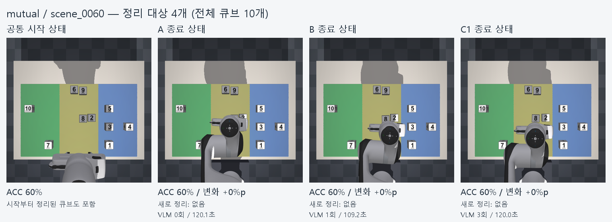

| 조건 | ACC | 증가 | F1 | 영상 | 그림 | 원본 |
|---|---|---|---|---|---|---|
| A | 60%→60% | +0%p | 0.730 | [원본 영상](trials/mutual/scene_0060/42/A/process.mp4) | [전](trials/mutual/scene_0060/42/A/before.png) / [후](trials/mutual/scene_0060/42/A/after.png) | [기록](trials/mutual/scene_0060/42/A/report.json) |
| B | 60%→60% | +0%p | 0.730 | [원본 영상](trials/mutual/scene_0060/42/B/process.mp4) | [전](trials/mutual/scene_0060/42/B/before.png) / [후](trials/mutual/scene_0060/42/B/after.png) | [기록](trials/mutual/scene_0060/42/B/report.json) |
| C1 | 60%→60% | +0%p | 0.730 | [원본 영상](trials/mutual/scene_0060/42/C/process.mp4) | [전](trials/mutual/scene_0060/42/C/before.png) / [후](trials/mutual/scene_0060/42/C/after.png) | [기록](trials/mutual/scene_0060/42/C/report.json) |

### mutual / scene_0070 — 정리 대상6개

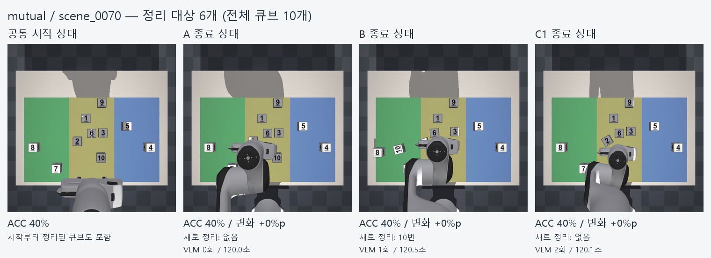

| 조건 | ACC | 증가 | F1 | 영상 | 그림 | 원본 |
|---|---|---|---|---|---|---|
| A | 40%→40% | +0%p | 0.571 | [원본 영상](trials/mutual/scene_0070/42/A/process.mp4) | [전](trials/mutual/scene_0070/42/A/before.png) / [후](trials/mutual/scene_0070/42/A/after.png) | [기록](trials/mutual/scene_0070/42/A/report.json) |
| B | 40%→40% | +0%p | 0.571 | [원본 영상](trials/mutual/scene_0070/42/B/process.mp4) | [전](trials/mutual/scene_0070/42/B/before.png) / [후](trials/mutual/scene_0070/42/B/after.png) | [기록](trials/mutual/scene_0070/42/B/report.json) |
| C1 | 40%→40% | +0%p | 0.571 | [원본 영상](trials/mutual/scene_0070/42/C/process.mp4) | [전](trials/mutual/scene_0070/42/C/before.png) / [후](trials/mutual/scene_0070/42/C/after.png) | [기록](trials/mutual/scene_0070/42/C/report.json) |

### mutual / scene_0080 — 정리 대상8개

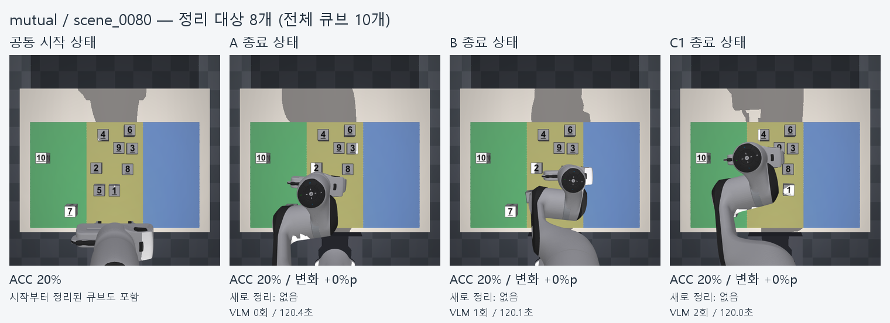

| 조건 | ACC | 증가 | F1 | 영상 | 그림 | 원본 |
|---|---|---|---|---|---|---|
| A | 20%→20% | +0%p | 0.286 | [원본 영상](trials/mutual/scene_0080/42/A/process.mp4) | [전](trials/mutual/scene_0080/42/A/before.png) / [후](trials/mutual/scene_0080/42/A/after.png) | [기록](trials/mutual/scene_0080/42/A/report.json) |
| B | 20%→20% | +0%p | 0.286 | [원본 영상](trials/mutual/scene_0080/42/B/process.mp4) | [전](trials/mutual/scene_0080/42/B/before.png) / [후](trials/mutual/scene_0080/42/B/after.png) | [기록](trials/mutual/scene_0080/42/B/report.json) |
| C1 | 20%→20% | +0%p | 0.286 | [원본 영상](trials/mutual/scene_0080/42/C/process.mp4) | [전](trials/mutual/scene_0080/42/C/before.png) / [후](trials/mutual/scene_0080/42/C/after.png) | [기록](trials/mutual/scene_0080/42/C/report.json) |

### mutual / scene_0090 — 정리 대상10개


| 조건 | ACC | 증가 | F1 | 영상 | 그림 | 원본 |
|---|---|---|---|---|---|---|
| A | 0%→0% | +0%p | 0.000 | [원본 영상](trials/mutual/scene_0090/42/A/process.mp4) | [전](trials/mutual/scene_0090/42/A/before.png) / [후](trials/mutual/scene_0090/42/A/after.png) | [기록](trials/mutual/scene_0090/42/A/report.json) |
| B | 0%→10% | +10%p | 0.167 | [원본 영상](trials/mutual/scene_0090/42/B/process.mp4) | [전](trials/mutual/scene_0090/42/B/before.png) / [후](trials/mutual/scene_0090/42/B/after.png) | [기록](trials/mutual/scene_0090/42/B/report.json) |
| C1 | 0%→0% | +0%p | 0.000 | [원본 영상](trials/mutual/scene_0090/42/C/process.mp4) | [전](trials/mutual/scene_0090/42/C/before.png) / [후](trials/mutual/scene_0090/42/C/after.png) | [기록](trials/mutual/scene_0090/42/C/report.json) |

## 자료 출처와 사용법

숫자는 data/report_summary.json 및 각 trials/.../report.json, 전후 그림은 before.png/after.png, 영상은 process.mp4에서 가져왔다. 모든 원본 복사 파일의 SHA256은 data/media_manifest.json에 기록했다. 생성 그림은 원본을 배치하거나 원본 수치를 시각화한 것이며 모델을 다시 실행하거나 점수를 바꾸지 않았다.

영상과 필터를 함께 보려면 폴더 전체를 내려받아 index.html을 브라우저에서 연다. README나PDF만 복사하면 연결된 영상이 함께 가지 않는다. PNG/PDF 그림은 assets/에서 보고서에 삽입하고, 인용 시 로컬120초 예비 실험·GPU·씬 수를 적는다.

그림·HTML·Markdown 생성기: tools/build_visual_report.py (조교의 Windows Python3.12 환경에서 실행). PDF는 브라우저 인쇄로 만들었으며, 배포 폴더를 입력으로 재생성하면 기존 PDF도 복사한다. 원본 실험 소스 커밋은 dbc6c693d14b6aaf9c8420157ec0e48b0de1c957이다.

배포 폴더에서 재생성하는 예:

```powershell
python tools/build_visual_report.py --source . --out ../local_pilot_rebuilt
```
