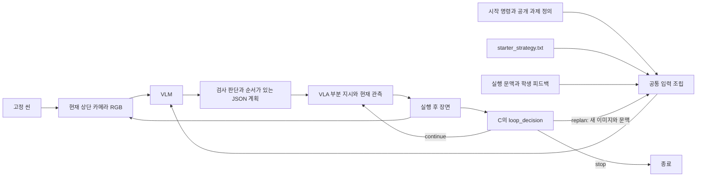

# Final project ver2.0 — 학생 실행·수정 안내

이 안내는 **어느 파일에 무엇을 넣고, 어떤 데이터가 다음 모듈로 전달되는지**를 설명합니다. 기준 폴더는 `vla_pipeline/`입니다. 기존 `vlapipe/student_design.py`는 v1 과제이므로 이 안내에서 수정하지 않습니다.

## 1. 먼저 알아둘 네 가지

| 구분 | 예 | 설정 위치 |
|---|---|---|
| 씬 | 물체의 위치·회전·로봇 초기 자세 | 고정한 씬 JSON, 실행 노트북의 `SCENE` / `CUSTOM_SCENE` |
| 시작 프롬프트 = 과제 명령 | `Tidy up the table.` | 실행 노트북의 `TASK_COMMAND`, 또는 씬 JSON의 `command` |
| VLM 내부 프롬프트 = 전략 | 이미지에서 접근성·방해물·목적지 점유를 보고 순서 결정 | `final_project_v2/prompts/starter_strategy.txt` |
| 피드백 루프 | 실행을 계속할지, 새 이미지로 다시 계획할지, 중단할지 | `final_project_v2/student_strategy.py`의 `loop_decision` |

**시작 프롬프트는 할 일이고, 내부 프롬프트는 그 일을 보고 판단하는 방법입니다.** 이미지는 파일 경로를 프롬프트 문자열에 쓰는 방식이 아니라, 실행기가 현재 시뮬레이터에서 촬영하여 VLM에 함께 전달합니다.

```text
vla_pipeline/
  notebooks/Final_project_v2_0.ipynb        ← 씬·시작 명령·모델·조건 선택
  final_project_v2/                         ← 학생이 다룰 파일
    prompts/starter_strategy.txt           ← B/C 공통 내부 프롬프트
    baseline_strategy.py                   ← 제공하는 완성 B
    student_strategy.py                    ← 학생 C 루프
    loop_example.py                        ← 명시 선택하는 C 연결 예제
  vlapipe/final_project_v2/                 ← 제공하는 실행·평가 기반
```

## 2. 제공된 완성 코드와 학생의 작업

| 조건 | 학생이 구현할 코드 | 실행에 필요한 설정 |
|---|---|---|
| A: VLA 단독 | 없음 | 씬·시작 명령·전체 정리용 VLA 모델 경로 |
| B: VLM 1회 + VLA | 없음. 완성된 `baseline_strategy.py` 제공 | 씬·시작 명령·VLM·부분 운반용 VLA 모델 경로 |
| C: 피드백 루프 | `student_strategy.py`의 `loop_decision` | B와 같은 초기 전략·모델, 관측 주기·재계획 조건 |
| D-state: 고전 제어 | 없음 | 씬·시작 명령 |
| E: 사람 조작 | 없음 | 로컬 Windows, 조이스틱·매핑·조작자 이름 |

B는 학생 C 파일을 읽지 않고 자체 완성 파일을 사용합니다. C의 함수가 아직 빈칸이어도 A·B·D를 실행할 수 있습니다. B의 기본 전략과 C의 기본 전략은 같은 TXT를 읽습니다. TXT의 전략 개선도 학생이 수행할 연구입니다.

완성 코드와 충분히 학습된 모델은 다릅니다. A/B에는 실제 저장 모델 경로가 필요하고, 짧게 학습한 모델은 정리 작업에 실패할 수 있습니다. 제공한 기준선이 언제나 성공하도록 정답 계획으로 바꾸지는 않습니다.

## 3. 처음 실행하는 순서

1. `notebooks/Final_project_v2_0.ipynb`를 엽니다. 로컬 확인은 프로젝트 `.venv`, 원격 학습·모델 실행은 `Select Kernel → Colab`의 GPU 커널을 선택합니다.
2. 설정 셀에서 `TEAM`, `SOURCE_ROOT`, `RUN_CONDITIONS`, 모델 경로를 확인합니다. 첫 실행은 기본 `RUN_CONDITIONS=['D']`로 합니다.
3. 설정 → bootstrap → scenes 셀을 순서대로 실행합니다. 출력된 `PROJECT`, `RUN`, `SCENES` 경로를 기록합니다.
4. `one_scene` 셀에서 사용할 씬과 공통 실행 함수를 설정합니다.
5. 조건별 셀을 실행하고 results 셀에서 영상·점수·종료 이유를 봅니다.

로컬 파일과 Colab 파일은 다릅니다. Windows에서 수정한 TXT/PY/JSON은 Git push한 브랜치 또는 **Upload to Colab**으로 옮긴 뒤 실제 원격 `SOURCE_ROOT`를 지정해야 적용됩니다. 노트북 설정 셀의 변수만 바꾸었더라도 그 변수를 사용하는 셀은 다시 실행해야 합니다.

출력 덮어쓰기는 하지 않습니다. 같은 조건을 다시 실행하려면 `one_scene` 셀을 다시 실행하여 새 `TRIALS` 폴더를 만들고, 비교할 조건들을 다시 실행합니다. 예전 결과는 보존됩니다.

## 4. 테스트용 씬은 어디에 넣을까?

### 기본 개발 씬 세 개

scenes 셀은 다음 경로를 만듭니다.

```text
SCENES/
  suite.json
  development/
    development_open_100.json
    development_blocked_101.json
    development_mixed_102.json
  train/          # 추가 데이터 수집용
  validation/     # 모델·설정 선택용
  sft_test/       # 학습 데이터의 별도 평가용
  test/           # 최종 비교용 혼합 씬 10개 이상
```

실행 노트북의 `one_scene` 셀에서 선택합니다.

```python
SCENE = DEV_SCENES[0]  # 모두 접근 가능한 개발 씬
# SCENE = DEV_SCENES[1]  # 정리 대상이 방해받는 개발 씬
# SCENE = DEV_SCENES[2]  # 접근 가능/방해받는 대상이 섞인 개발 씬
```

`blocked`는 정리 대상이 막혔다는 뜻입니다. 먼저 옮길 수 있는 방해물도 모두 이동 불가능하게 만들면 해결할 수 없는 씬이 됩니다.

### 직접 만든 씬

`Scene_designer_v2_0.ipynb`에서 좌표를 편집하고 **freeze → preview**를 실행합니다. 마지막에 출력되는 `student_scene.json`처럼 **초기 상태가 고정된 파일**을 실행에 사용합니다. 좌표만 바꾼 `edited_scene.json`을 그대로 실행하지 않습니다.

실행 노트북 설정 셀에 그 JSON의 실제 경로를 넣습니다.

```python
# Windows 예시. 실제 파일 경로로 바꾸세요.
CUSTOM_SCENE = r'C:\my_project\vla_pipeline\outputs\my_run\student_scene.json'

# Colab 예시. Windows C: 경로를 여기에 쓰지 않습니다.
# CUSTOM_SCENE = '/content/my_scenes/student_scene.json'
```

기본 `one_scene` 셀은 이 값을 사용합니다. 또는 이미 `PROJECT`가 준비된 상태라면 직접 선택할 수 있습니다.

```python
SCENE = PROJECT / 'outputs/my_run/student_scene.json'
```

하나의 JSON을 A/B/C/D/E에 공통으로 사용해야 합니다. 조건마다 다시 랜덤 생성하지 않습니다. 실행기는 저장된 로봇·물체 상태를 복원하고 상태 해시를 기록합니다.

직접 만든 여러 씬을 suite로 묶을 때는 프로젝트 루트에서 다음 명령을 씁니다.

```powershell
.\.venv\Scripts\python.exe scripts/final_project_v2.py register-scenes --scene outputs/scene1.json --scene outputs/scene2.json --out outputs/my_suite
```

이후 설정 셀의 `SCENES_ROOT`에 `outputs/my_suite`의 실제 절대 경로를 넣습니다. 각 JSON의 `split`, `seed`, `family`, 고유 ID를 기록하세요. 같은 원본의 변형은 같은 family에 두며 학습·시험 양쪽에 나누지 않습니다. 최종 시험은 `SPLIT='test'`, `FINAL_TEST=True`로 명시합니다.

## 5. 시작 프롬프트는 어디에 넣을까?

실행 노트북 설정 셀의 `TASK_COMMAND`입니다.

```python
TASK_COMMAND = 'Tidy up the table.'
```

이 값이 비어 있으면 씬 JSON의 `command`를 사용합니다. 값이 있으면 실행기에 `--task-command`로 전달되어 그 시험의 A~E에 같은 명령을 적용합니다. 실제 사용 명령은 각 시험 폴더의 `scene.json`과 `task.json`에 남습니다. 원본 JSON은 덮어쓰지 않습니다.

씬 자체에 저장하려면 씬 설계 노트북에서 freeze 전에 다음을 넣습니다.

```python
editable['command'] = 'Tidy up the table.'
```

현재 과제의 분류 규칙은 **1~5번 오른쪽 / 6~10번 왼쪽**으로 고정되어 있습니다. `TASK_COMMAND='Put everything on the left.'`라고 써도 채점 규칙이 바뀌지 않습니다. 목표·물체 수·채점 대상을 바꾸는 연구는 환경·데이터·모델·평가 규칙을 함께 수정해야 합니다.

A에는 전체 과제와 완전한 분류 규칙을 포함한 짧은 언어 입력이 들어갑니다. 긴 문장은 VLA의 언어 처리 길이 제한에 걸릴 수 있으므로 먼저 짧은 영어 명령으로 연결을 확인합니다. B/C의 VLM에는 같은 과제에 추가 전략·출력 형식이 붙습니다.

추가 데이터 노트북에서도 `TASK_COMMAND`를 설정하면 초기 VLM 후보 생성과 VLA 전체 시연 라벨에 같은 명령이 적용됩니다.

## 6. VLM 내부 프롬프트는 어떻게 설정할까?

수정할 파일은 `final_project_v2/prompts/starter_strategy.txt`입니다. 이미 실행 가능한 시작 전략이 들어 있습니다. 다음 질문에 대한 판단 방법을 여기에 작성합니다.

- 지금 이미지에서 어떤 물체가 어느 구역에 보이는가?
- 어느 물체에 그리퍼가 접근할 공간이 있는가?
- 목표 놓기 자리 또는 파지 경로를 누가 막고 있는가?
- 무엇을 먼저 옮길 것인가?
- 현재 이미지에서 완료 또는 실패를 어떻게 판단할 것인가?
- 이전 실행이 끝났는데 결과가 불충분하면 무엇을 바꿀 것인가?

예를 들어 파일의 전략 문장 일부를 다음처럼 바꿀 수 있습니다. 실제 효과는 개발·validation에서 확인합니다.

```text
Inspect the image before choosing an action. First check the target object's
grasp clearance and whether its fixed destination is occupied. If another
object blocks either place, plan to transport an accessible blocker first.
Use the new image and execution history to avoid blindly repeating a failed
action. Keep reasons short and output only the required JSON.
```

**이미지의 실제 정답 좌표, 정답 접근성 판정, 성공 채점 결과는 프롬프트에 주어지지 않습니다.** 공개된 고정 놓기 좌표는 목표 정의입니다. 현재 물체가 그 좌표에 있는지는 이미지를 보고 판단해야 합니다.

TXT를 바꾸면 기본 B와 C에 함께 적용됩니다. C의 `build_prompt` 함수를 별도로 바꾸면 B와 초기 입력이 달라질 수 있습니다. 루프 효과만 비교하려면 `B_STRATEGY=C_STRATEGY`로 같은 프롬프트 함수를 사용하거나 공통 TXT만 수정하세요. B는 그 파일의 `loop_decision`을 실행하지 않습니다.

## 7. VLM이 실제로 받는 데이터



루프 분기는 C에만 적용됩니다. B는 처음 만든 plan을 순서대로 실행하고 VLM을 다시 부르지 않습니다.

공통 코드가 아래 순서로 입력을 조립합니다.

1. 시작 명령과 분류 규칙.
2. 공개 물체 ID·설명·목표 구역·고정 놓기 자리.
3. TXT의 전략과 실행 문맥.
4. 공통 JSON 응답 형식.

현재 구현은 이 텍스트와 이미지를 **하나의 user 메시지**로 모델에 전달합니다. TXT는 역할상 내부 전략 지시문이지만, API의 별도 system 메시지를 추가하는 설정은 아닙니다. 학생이 GPU 로딩이나 이미지 전달 코드를 복제할 필요는 없습니다.

최초 B/C 문맥은 정확히 다음과 같습니다.

```python
{'event': 'initial', 'history': [], 'feedback': None}
```

`build_prompt(public_task, context)`는 **문자열**을 반환합니다. 기본 함수는 TXT와 문맥을 합칩니다. 이미지 배열을 문자열로 붙이거나 파일 경로만 쓰지 마세요. 재계획 시 새 이미지 전달은 실행기가 담당합니다.

실제 입력을 확인하려면 해당 시험의 `plan_001.png`와 `plan_001.json`을 여세요. JSON의 `prompt`는 조립된 전체 입력, `context`는 그때 전달된 문맥, `raw`는 실제 모델 응답입니다. TXT의 사본은 `starter_strategy_used.txt`에 남습니다. 최종적으로 무엇을 보냈는지는 각 `plan_*.json`의 `prompt`가 기준입니다.

## 8. VLM이 반환해야 하는 답변

아래는 **형식을 보여주는 예**이며 특정 씬의 정답이 아닙니다.

```json
{
  "assessments": [
    {"object": "object_6", "accessible": false, "blockers": ["object_1"], "reason": "Object 1 obstructs the grasp approach."},
    {"object": "object_1", "accessible": true, "blockers": [], "reason": "The blocker appears reachable."}
  ],
  "plan": [
    {"object": "object_1", "target_zone": "right_zone", "reason": "Clear the blocker first."},
    {"object": "object_6", "target_zone": "left_zone", "reason": "Transport after clearance."}
  ],
  "done": false
}
```

| 필드 | 의미 |
|---|---|
| `assessments` | 이미지로 판단한 접근성·방해물·짧은 근거 목록 |
| `plan` | **실제로 실행할 운반 순서**. `object`와 `target_zone` 필수 |
| `done` | 모델이 완료라고 판단했는지. true이면 plan은 빈 배열이어야 함 |

`assessments`의 false가 자동으로 액션을 차단하지는 않습니다. **실행기는 plan을 실행합니다.** 따라서 모델이 자신의 접근성 판단을 plan의 순서에 반영하도록 프롬프트를 설계해야 합니다.

실행기는 plan 한 항목을 VLA용 언어 지시로 바꿉니다.

```text
object_6 + left_zone
→ Pick up the cube number 6 and place it in the left storage zone.
```

VLA는 이 지시와 현재 두 카메라 이미지·로봇 상태16을 받아 action7을 출력합니다. 학생은 JSON을 관절 명령으로 직접 변환하지 않습니다. `reason`은 기록용이며 VLA에 그대로 전달되지 않습니다. 지원 스킬은 운반이고, JSON에 push를 써서 새 물리 스킬을 추가할 수는 없습니다.

형식 오류·없는 ID는 기록하고 실행하지 않습니다. 모델이 잘못 고른 목적지를 정답으로 자동 수정하지 않습니다. `done=true`도 정답 채점 결과가 아니며 실제 배치로 별도 평가합니다.

## 9. 루프 코드는 어디에 쓰고 어떻게 연결할까?

파일은 `final_project_v2/student_strategy.py`입니다. 이미 `build_prompt`의 기본 연결이 들어 있으므로 **`loop_decision(context)`**를 작성합니다. 실행 노트북 bootstrap 셀은 다음처럼 경로를 연결합니다.

```python
C_STRATEGY = PROJECT / 'final_project_v2/student_strategy.py'
B_STRATEGY = PROJECT / 'final_project_v2/baseline_strategy.py'
```

`trial('C')`가 C_STRATEGY 경로를 `--strategy`로 전달하면 실행기가 파일을 불러오고 함수를 호출합니다. 수정 파일이 실제 Colab의 PROJECT 아래에 있어야 합니다. 함수 이름을 바꾸지 않습니다.

### 루프 함수의 입력

| 키 | 데이터 | 의미 |
|---|---|---|
| `event` | 문자열 | 언제 판단하는지 |
| `feedback` | dict | 현재 사건의 실행 지시·스텝 수·종료 이유 등 |
| `history` | dict 목록, 최근20개 | 이전 실행 메타데이터. 이전 RGB 프레임 목록은 아님 |
| `remaining_seconds` | float | 공통 제한 시간까지 남은 실제 시간 |
| `remaining_calls` | int | 더 사용할 수 있는 VLM 호출 수 |
| `queued_actions` | plan 항목 목록 | 기존 계획의 남은 운반 지시 |
| `last_model_response` | dict 또는 None | 직전 VLM의 파싱된 응답 |
| `observation.agentview_image` | uint8 NumPy RGB 배열 | 현재 상단 이미지, 기본 `(512,512,3)` |
| `observation.robot0_eye_in_hand_image` | uint8 NumPy RGB 배열 | 현재 손목 이미지, 기본 `(128,128,3)` |

이미지는 loop_decision에서 분석할 때 사용하는 입력입니다. 그 배열을 반환 feedback에 그대로 넣으면 JSON으로 저장할 수 없습니다. 분석 결과를 짧은 문자열·수치·불리언·목록·dict로 정리하세요.

### 호출되는 사건

| event | 호출 시점 | 주의 |
|---|---|---|
| `observation_tick` | 동작 도중 OBSERVER_STEPS마다 | 이 시점에 replan하면 현재 부분 실행을 중단하고 새 계획 요청 |
| `after_action` | 부분 지시의 ACTION_STEPS 실행 후 | 성공을 뜻하지 않음 |
| `plan_exhausted` | 기존 계획이 비었을 때 | 계속할 계획이 없으므로 continue만으로 작업이 진행되지는 않음 |
| `invalid_plan` | VLM 응답을 실행 가능한 JSON으로 읽지 못했을 때 | 새 호출도 실패할 수 있으므로 횟수·시간 한도를 고려 |

예를 들어 부분 실행 후 feedback은 다음과 같습니다.

```python
{
    'event': 'after_action',
    'instruction': 'Pick up the cube number 6 and place it in the left storage zone.',
    'action': {'object': 'object_6', 'target_zone': 'left_zone', 'reason': '...'},
    'steps': 240,
    'termination': 'fixed_action_horizon'
}
```

여기에는 정답 `success`가 없습니다. `feedback['success']`로 분기하면 오류가 납니다. 실행 종료와 성공을 구분하고 이미지·직전 모델 판단·이력에서 재검사가 필요한 근거를 정해야 합니다.

### 루프 함수의 출력

| 반환값 | 실행기 동작 |
|---|---|
| `'continue'` | 현재 동작이나 남은 계획을 이어감 |
| `'replan'` | 새 상단 이미지와 최신 문맥으로 VLM 재호출, 기존 남은 계획 교체 |
| `'stop'` | 학생 전략의 중단으로 종료 |
| `{'decision': 'replan', 'feedback': ...}` | 학생의 해석도 다음 VLM 문맥의 `feedback.student_feedback`에 전달 |

예를 들어 이미지 분석으로 실패를 의심했다면 다음처럼 전달할 수 있습니다. 아래 문자열은 학생이 분석으로 얻어야 할 값이며 기반 코드가 정답으로 주는 값이 아닙니다.

```python
return {
    'decision': 'replan',
    'feedback': {
        'suspected_failure': 'The intended object seems to remain outside its goal zone.',
        'request': 'Check the new image and reconsider the blocker order.'
    }
}
```

그다음 `build_prompt`가 이 문맥을 내부 프롬프트에 포함하고, 공통 실행기가 **그 시점의 새 이미지**를 VLM에 보냅니다. 학생이 VLM 로딩 코드를 loop_decision 안에 다시 넣을 필요는 없습니다.

### 실행 연결을 확인하는 최소 예제

`final_project_v2/loop_example.py`는 다음 연결 정책을 완성해 둔 예제입니다.

```python
def loop_decision(context):
    if context['remaining_seconds'] <= 0 or context['remaining_calls'] <= 0:
        return 'stop'
    if (context.get('feedback') or {}).get('model_done'):
        return 'stop'
    if context['event'] in ('after_action', 'invalid_plan', 'plan_exhausted'):
        return 'replan'
    return 'continue'
```

연결만 확인할 때는 bootstrap 이후 `C_STRATEGY=PROJECT/'final_project_v2/loop_example.py'`로 명시하고 C를 실행합니다. 예제는 동작 후마다 재호출하므로 비용이 큽니다. 언제 재호출해야 유리한지, 불필요한 재계획을 어떻게 줄일지는 학생이 설계·비교할 부분입니다. 기본 student_strategy의 빈칸을 자동으로 우회하지 않습니다.

## 10. A·B·D부터 실행하는 설정 예

아래 경로의 RUN_ID는 실제 Drive 폴더로 바꾸세요. `pretrained_model` 폴더 전체가 필요합니다.

```python
RUN_CONDITIONS = ['A', 'B', 'D']
VLA_SCENE = '/content/drive/MyDrive/VLA2026/your_run/models/single/pretrained_model'
VLA_SUBTASK = '/content/drive/MyDrive/VLA2026/your_run/models/hier/pretrained_model'
TASK_COMMAND = 'Tidy up the table.'
SECONDS = 120
```

설정 후 bootstrap → scenes → one_scene → A/B/D → results 순서로 실행합니다. 12초 기본값은 연결 검사입니다. 위120초도 연구의 정답 예산이 아니므로 예비시험으로 정하고 모든 조건에 고정합니다. 모델 경로를 비워 두면 A/B는 명확한 오류로 멈춥니다. 고전 제어로 바꿔서 VLA라고 표시하지 않습니다.

CLI에서 B는 이제 학생 전략 경로 없이도 실행할 수 있습니다.

```powershell
.\.venv\Scripts\python.exe scripts/final_project_v2.py trial --condition B --scene outputs/my_scenes/development/development_open_100.json --checkpoint outputs/my_hier/checkpoints/000001/pretrained_model --task-command "Tidy up the table." --out outputs/my_B
```

여러 씬을 비교하는 suite에서는 `--b-strategy`가 B, `--strategy`가 C의 파일입니다. 생략한 B 경로는 완성 기준선으로 설정됩니다.

## 11. 비교 전에 확인할 것

- A/B/C/D/E가 같은 고정 씬 JSON과 같은 시작 명령을 쓰는가?
- B와 C의 최초 `plan_001.json`의 prompt가 같은가? 실제 최초 입력 해시가 다르면 B/C 짝 비교에서 제외하고 경고한다.
- B와 C가 같은 VLM·VLA를 쓰는가? A의 모델은 전체 과제, B/C의 모델은 부분 운반을 학습했는가?
- 시간·스텝·호출·재시도 한도를 기록했는가?
- 최종 시험으로 프롬프트를 계속 고르지 않았는가?
- 모델의 계획 F1과 실제 최종 배치의 F1을 구분했는가?

## 12. 문제가 생겼을 때 볼 파일

| 현상 | 먼저 볼 곳 |
|---|---|
| 내가 바꾼 프롬프트가 적용되지 않음 | 원격 PROJECT 경로, TXT 업로드 여부, `plan_001.json.prompt` |
| 내가 바꾼 씬이 적용되지 않음 | `SCENE`, `CUSTOM_SCENE`, 해당 시험 `scene.json`, 초기 이미지 |
| B가 C의 빈칸 때문에 멈춤 | `B_STRATEGY`를 제공 baseline 파일로 지정했는지 |
| C가 NotImplementedError | student_strategy의 loop_decision이 아직 빈칸인지. 연결 예제는 명시 선택 |
| C가 재계획을 하지 않음 | `events.jsonl`의 student_decision, return 값, 관측 주기 |
| VLM 호출만 반복하고 로봇이 안 움직임 | `plan_*.json.raw`, parse_error, 빈 plan, 시간·호출 한도 |
| accessible=false 물체를 그대로 집음 | assessments만 쓰고 plan에 그 물체를 먼저 넣었는지 |
| 셀을 다시 실행했더니 출력 폴더 존재 오류 | one_scene 셀부터 새 비교 폴더를 만들었는지 |
| Windows 파일을 고쳤는데 Colab에 반영 안 됨 | 로컬과 원격은 별도. push/업로드 후 실제 SOURCE_ROOT 확인 |

관련 안내: [ver2.0 전체 실행·지표·저장](FINAL_PROJECT_V2.md), [씬 설계 노트북](../notebooks/Scene_designer_v2_0.ipynb), [실행 노트북](../notebooks/Final_project_v2_0.ipynb).
